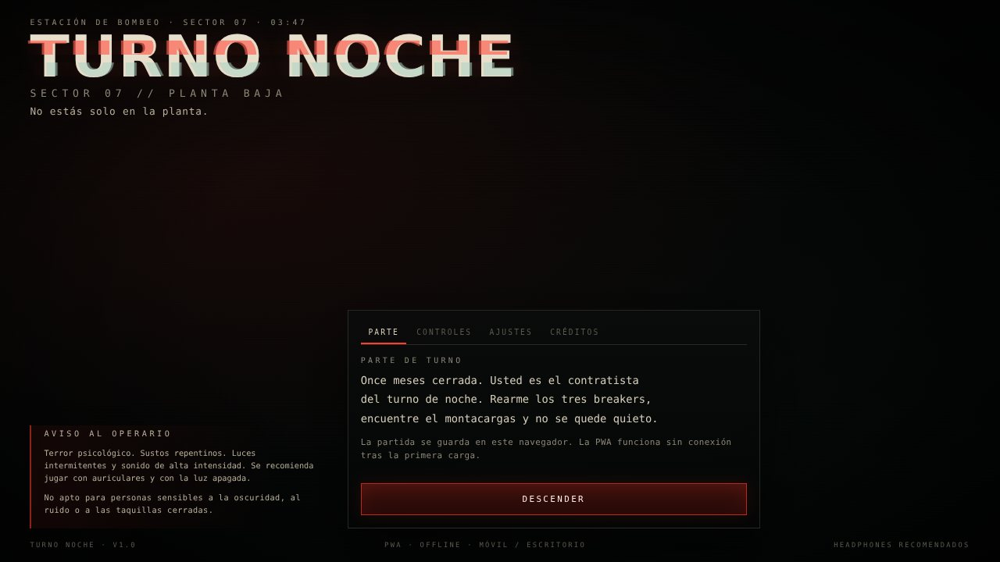
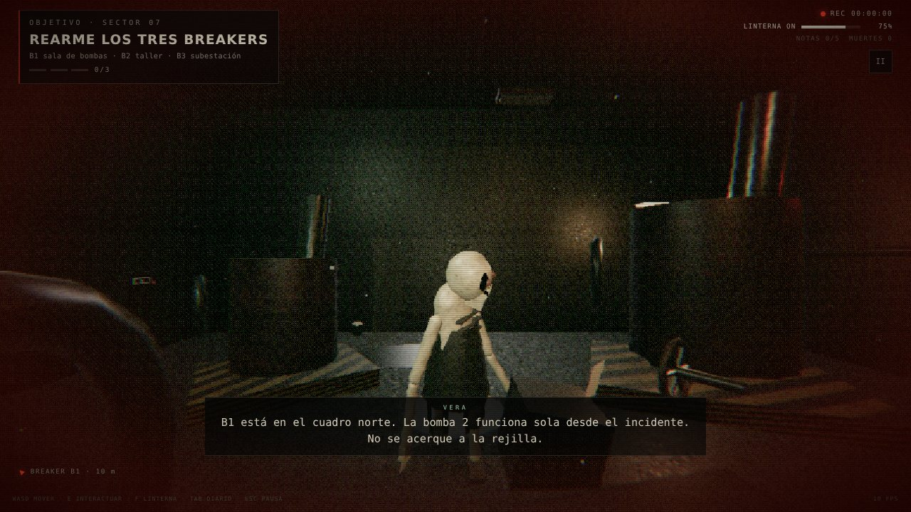
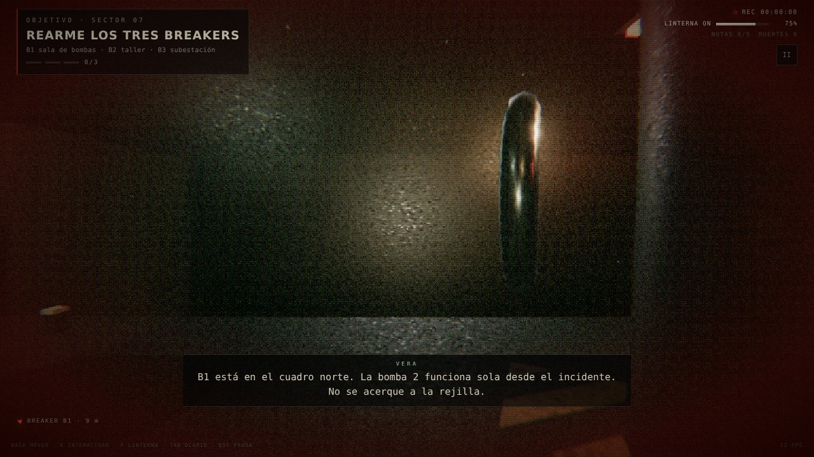
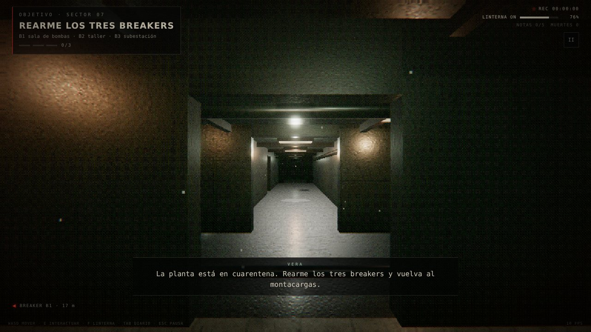
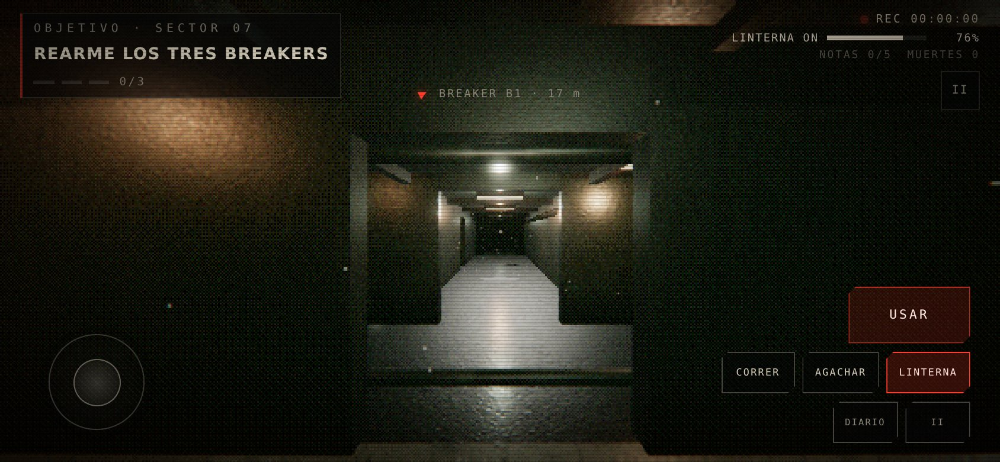

# TURNO NOCHE

**Terror en primera persona para navegador y móvil.** Estación de bombeo «Planta Baja», Sector 07,
03:47. Once meses cerrada. Usted es el contratista del turno de noche.

[](https://jlaguna553.github.io/turno-noche/)
[](#instalar-como-app-pwa)
[](#pruebas)



> **Aviso de contenido.** Terror psicológico, sustos repentinos, luces intermitentes, sonido de
> alta intensidad y espacios cerrados. Se recomienda jugar con auriculares. No apto para personas
> sensibles a la oscuridad o al ruido.

---

## Qué es

Un juego corto de terror (una sesión de 10 a 20 minutos) construido como **PWA**: se abre en el
navegador, se instala en la pantalla de inicio y funciona **sin conexión** tras la primera carga.
Sin descargas, sin cuentas, sin servidor.

- **Motor:** three.js r187 (WebGL2) + Rapier 0.21 (WASM). Física de personaje con el modelo de
  movimiento de Source (fricción + `accelerate`, autostep, crouch con collider real).
- **Arte y audio:** 100 % procedurales. Texturas, geometría, criatura, efectos y voces se generan
  por código en el navegador. Cero assets externos.
- **Nivel:** planta de bombeo con siete zonas en bucle, tres breakers, cinco notas, taquillas para
  esconderse y un montacargas con dos finales.
- **Interfaz:** React 19 sobre el canvas; el motor 3D no usa reconciliación en el camino caliente.
- **Móvil:** stick analógico, arrastre de cámara, botones de acción, pantalla completa y orientación
  horizontal.

## Cómo se juega

Reactive **B1** (sala de bombas), **B2** (taller) y **B3** (subestación). Después vuelva al
montacargas de la garita. Algo patrulla la planta, oye sus pasos y ve su linterna.

| Tecla | Acción |
| --- | --- |
| `WASD` | moverse |
| `SHIFT` | correr (hace mucho ruido) |
| `CTRL` / `C` | agacharse (casi silencio) |
| `E` | interactuar: notas, breakers, taquillas, montacargas, radio |
| `F` | linterna |
| `TAB` | diario de notas |
| `ESC` | pausa |

En móvil: stick a la izquierda, arrastre a la derecha y botones **USAR / CORRER / AGACHAR /
LINTERNA / DIARIO / II**. El dispositivo se juega en horizontal.

### Lo que hay que saber para sobrevivir

- **La linterna es una elección.** Ilumina, pero también alarga el alcance visual de la criatura.
  La batería se agota; hay pilas repartidas por la planta.
- **Correr es ruidoso.** Agacharse reduce el ruido y la altura de la cámara. La criatura investiga
  los ruidos aunque no le vea.
- **Las taquillas con marca blanca son escondites.** Dentro no puede moverse; la vista queda
  reducida a una rendija. `E` para salir.
- **Los breakers hacen ruido.** Cada uno cambia el estado de la planta y el comportamiento de la
  criatura. El tercero la despierta del todo.
- **La radio de la garita da pistas** si no sabe dónde ir. El HUD marca el siguiente objetivo.
- **Los sustos no son solo scripted.** Hay eventos ambientales (golpes en tuberías, pasos lejanos,
  susurros, luces que mueren) además de las apariciones guionizadas.

## Capturas

| La criatura | Sala de bombas |
| --- | --- |
|  |  |

| Juego en escritorio | Juego en móvil |
| --- | --- |
|  |  |

## Jugar

**En línea:** <https://jlaguna553.github.io/turno-noche/>

### Instalar como app (PWA)

- **Android / Chrome:** abra la URL, menú → «Añadir a la pantalla de inicio» / «Instalar
  aplicación». Se abre a pantalla completa en horizontal.
- **iOS / Safari:** Compartir → «Añadir a pantalla de inicio».
- **Escritorio / Chrome o Edge:** icono de instalar en la barra de direcciones.

El service worker precachea el shell y los assets de la build; tras la primera carga el juego
arranca **sin red**, verificado en el QA (modo offline de Chromium).

## Ejecutar en local

Requisitos: **Node 20.19+** (probado en 20.20 y CI en 22) y un navegador con WebGL2.

```bash
npm install
npm run dev        # http://localhost:5180
```

```bash
npm run typecheck  # tsc --noEmit
npm test           # vitest: 31 pruebas
npm run build      # tsc + vite build -> dist/
npm run preview    # sirve dist/ en :4173
npm run icons      # regenera los iconos PWA procedurales
```

Para probar la PWA en local use `npm run build && npm run preview`: en `vite dev` el service
worker no se registra a propósito.

## Cómo está hecho

```text
src/
├── main.tsx / App.tsx        orquestación UI ↔ motor, fases y pantallas
├── game/
│   ├── engine.ts             loop 60 Hz, interacción, IA, objetivos, checkpoint/muerte, finales
│   ├── core/                 bus tipado, input (teclado/táctil), config, guardado, PRNG
│   ├── physics/              mundo Rapier y raycasts
│   ├── player/               controlador Source-like + matemática de movimiento pura
│   ├── render/               materiales procedurales y post-proceso PSX/VHS
│   ├── audio/                WebAudio procedural: drones, latidos, pasos, criatura, radio
│   ├── logic/                estado puro y testeable: objetivos, batería, FSM de la criatura,
│   │                         guion, notas, finales
│   └── world/                layout, navegación A*, props, criatura procedural, mundo
├── ui/                       portada, prólogo, HUD, táctil, pausa, diario, muerte, finales
└── public/                   manifest, service worker e iconos
```

Decisiones que sostienen el juego:

- **Un solo cuerpo fijo de Rapier** para toda la geometría estática; el jugador y la criatura son
  cápsulas cinemáticas con `KinematicCharacterController`.
- **Simulación a 60 Hz fijos** con acumulador y cámara interpolada; el render nunca cambia la
  física.
- **Datos puros en `logic/`**: el cerebro de la criatura, la batería y los objetivos se prueban en
  vitest sin DOM ni WebGL.
- **Post-proceso único** (bloom tenue + grading con viñeta, grano, aberración, tramado ordenado,
  scanlines y bandas VHS). `uFear` corrompe la imagen cuando la criatura se acerca: el miedo se
  ve, no solo se cuenta.
- **Resolución interna reducida** (0,56× / 0,70× / 0,86× según calidad) y escalado con
  `image-rendering: pixelated`: estética PSX y más fotogramas en GPU móvil.
- **Audio espacializado**: la respiración de la criatura se panea según su dirección relativa y
  sube con la cercanía. Es el canal de información principal.
- **Guardado local** de breakers, notas, muertes, tiempo y final; el checkpoint es la garita.

### Por qué no se usan assets de Valve (ni de nadie)

La petición original hablaba de reutilizar personajes y criaturas de Valve. **Eso no es legal**:
los modelos, texturas, sonidos y nombres de Half-Life siguen siendo propiedad de Valve aunque se
modifiquen, y subirlos a GitHub es una infracción. Este proyecto hace lo contrario:

- **Cero material de terceros.** Cada textura, malla, sonido y línea de guion es original y se
  genera por código.
- **La inspiración es de género, no de material.** El look GoldSrc/PSX (baja resolución, niebla,
  luces fluorescentes, geometría industrial) se consigue con shaders y arte procedural, no
  copiando assets.
- **Se reutiliza el motor, no el contenido.** La base de motor web (three.js + Rapier, física
  Source-like, PWA) viene del arnés de **half-web / PACKETWORKS**, código del mismo autor; el
  contenido de aquel juego (redes, VLAN, reparto) no se ha portado.

El resultado es un juego publicable, instalable y legal, con la misma sensación de FPS de terror
industrial.

## Pruebas

```bash
npm test                      # 31 pruebas unitarias
node scripts/e2e-smoke.mjs    # requiere npm run dev y Chromium
```

- **Vitest (31):** objetivos y notas, batería y ruido, FSM de la criatura (visión, oído, linterna,
  escondite, agresividad, alertas), navegación A* y simetría del grafo, integridad del layout,
  zonas, props, breakers, escondites y textos de prólogo/finales.
- **QA E2E (30 comprobaciones)** con Chromium real y SwiftShader: portada → prólogo → nota con
  `E` → diario → susto de la sala de bombas → B1 con interacción real → linterna → escondite y
  salida → tres breakers → clímax → montacargas → decisión final → final → persistencia tras
  recargar → muerte y reintento → controles táctiles y pausa en viewport 844×390.
- **QA PWA:** manifiesto, iconos, service worker controlando la página, 12 entradas en caché
  (shell + assets con hash) y arranque completo del juego **con la red desconectada**.
- El E2E falla ante cualquier error de consola. Evidencia de la última pasada: **0 fallos, 0
  errores de consola**.

### Rendimiento y peso (medido en esta build)

| Chunk | Raw | gzip |
| --- | --- | --- |
| `index` (UI + lógica + App) | 38 KB | 12 KB |
| `engine` (mundo, IA, narrativa) | 103 KB | 32 KB |
| `react` | 219 KB | 68 KB |
| `three` | 582 KB | 144 KB |
| `rapier` (WASM base64) | 4,33 MB | 1,67 MB |
| CSS | 26 KB | 7 KB |
| **Total** | **~5,3 MB** | **~1,9 MB** |

Rapier es ~82 % del peso. La pantalla de arranque pinta antes de cargar el motor (import
dinámico). En el QA headless con SwiftShader se miden 10–20 fps: es render por software, no
representativo de una GPU real. En móvil la calidad arranca en `low` (resolución interna 0,56×).

## Límites honestos

- Un único escenario y una criatura. No hay esqueletos ni captura de movimiento: la animación es
  procedural (poses y mezclas por código).
- Guardado local al navegador; borrar los datos del sitio borra el turno.
- Sin multijugador, sin cuentas, sin nube.
- Si el navegador rechaza `requestPointerLock`, se puede mirar arrastrando con el botón izquierdo;
  el juego avisa con la pausa.
- El nivel es contenido, no fontanería: añadir zonas es editar `world/layout.ts`.

## Créditos

- Diseño, código, arte procedural, audio y guion: **Javier Laguna**.
- Motor base y arquitectura de referencia: arnés de **half-web / PACKETWORKS** (código propio).
- Inspiración estética: shooters industriales de finales de los 90, terror analógico y plantas de
  bombeo reales. Sin material copiado.

## Licencia

Código bajo licencia **MIT** (ver [`LICENSE`](LICENSE)). El arte y el audio se generan por código
dentro de este repositorio y quedan cubiertos por la misma licencia. No se incluye ni se
redistribuye material de Valve, Half-Life ni de terceros.
